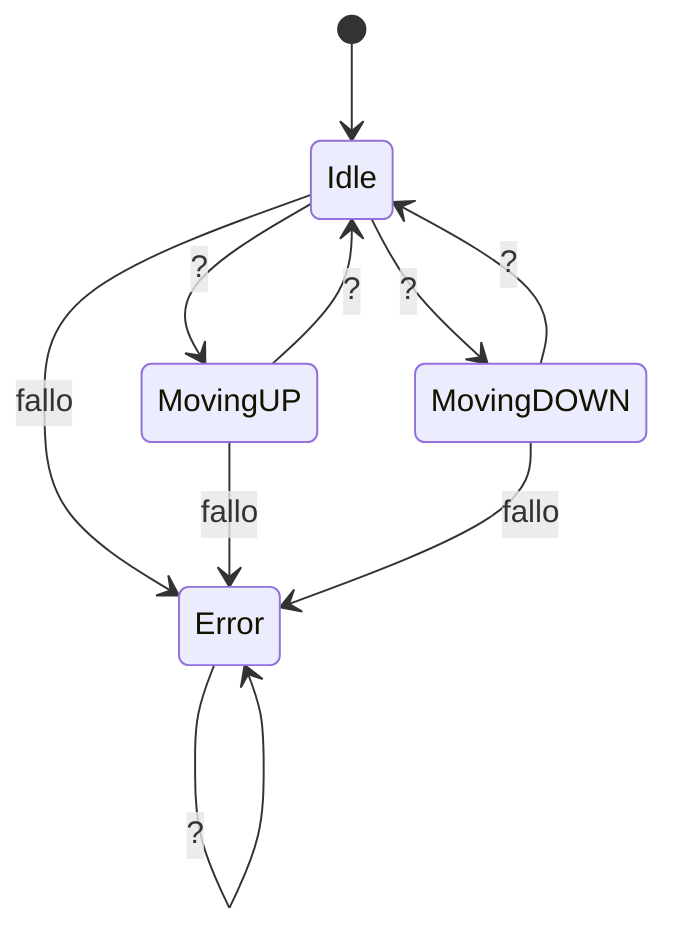
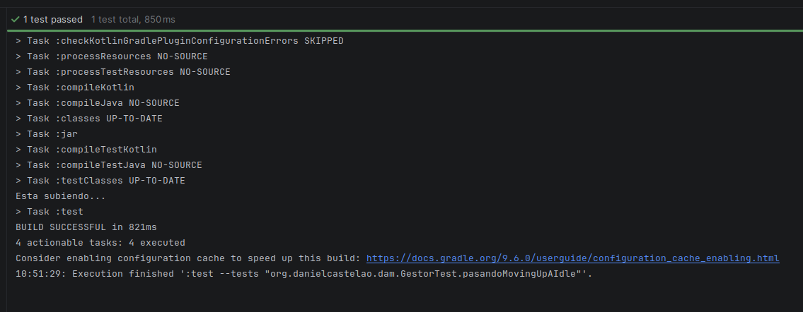
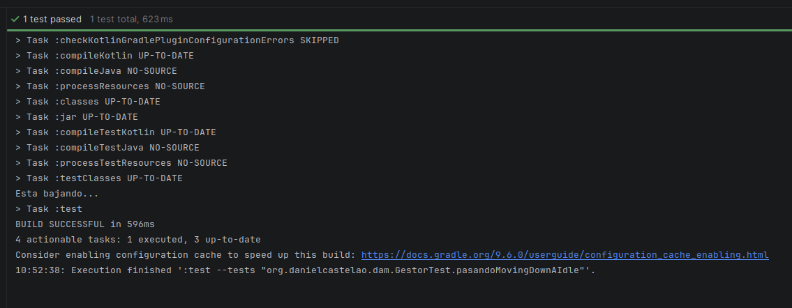

# Examen Máquina de Estados

## Como se planteo

Este proyecto se planteo a partir del diagrama de abajo, una vez se entra en el ascensor
se podra dar a un boton mediante una botonera, depende a que boton le des pasa una cosa.
El rpograma fue hehco para que si das en el piso 0 el boton del piso 0 falle, lo mismo sucede
en el piso 1. Una vez le des al boton correspondiente se pasara al estado de MovingUp o MovingDown,
en el que no se podra tocar ningun boton. Si se toca un boton en este periodo la maquina falla
puesto que esta subiendo/bajando por lo que no se deberia tocar el boton. Una vez llegue
a su destino volvera al estado inicial en el que si tocas un boton se mantendra ahi.
## Diagrama de estados

## Problemas a la hora de hacer este proyecto

Nuestro equipo sufrio mucho en algunos aspectos al crear este proyecto, aparte de porblemas
imprevistos a la hora de crear el repositorio, hubo un principal problema. A la hora de implementar
la botonera se tiene es boton que representa el 0 y el boton que representa el 1, cada uno siendo boolean
representando que esta pulsado o no, el problema es que al tener un atributo true-false,
el proyecto a veces falla, nuestro equipo no aun del todo porque es pero antes de ser implementado la botonera
las pruebas que se habian hecho (no me acuerdo en que commit) habian salido bien. No se sabe si es porque
al ser una clase actua diferente.

## Capturas

